# 交通规划 · Transport Plan

<p align="center">
  <b>如果一座车站建成后永远不能拆，你还会把它放在这里吗？</b>
</p>

<p align="center">
  浏览器端城市交通规划模拟 · 10 万+ 出行个体 · 真实活动链 · 永久车站 · 每日经营结算
</p>

<p align="center">
  
  
  
  
  
</p>

> 你在一张真实路网切片上建站、画线、加车、定价，看 10 万+ 出行个体如何被一张线网改变。
>
> **车站一旦建成，永久保留。** 放站是承诺，不是试错。  
> **游戏没有终点**：没有计划行程目标，也没有必须达成的覆盖率。

<p align="center">
  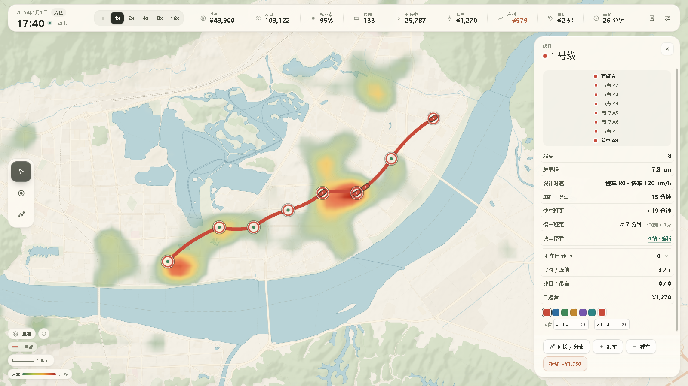
</p>

<p align="center">
  <a href="docs/video/交通规划-实机演示.mp4">▶ 观看 2 分钟实机演示</a>
  ·
  <a href="#快速开始">快速开始</a>
  ·
  <a href="#玩法">玩法</a>
</p>

## 实机截图

<p align="center">
  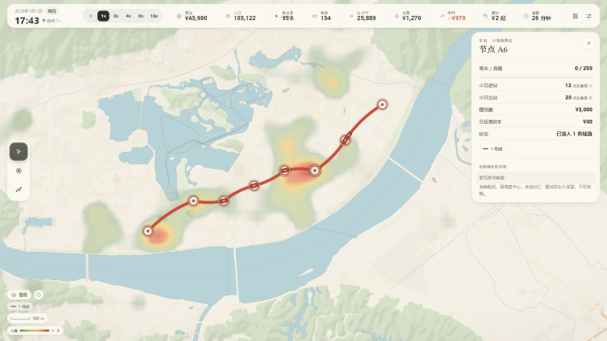
  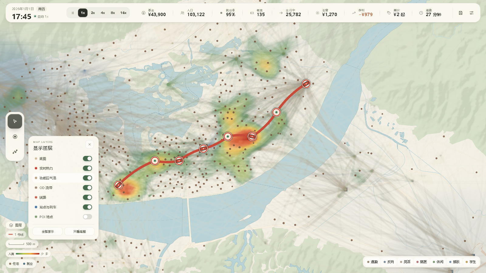
  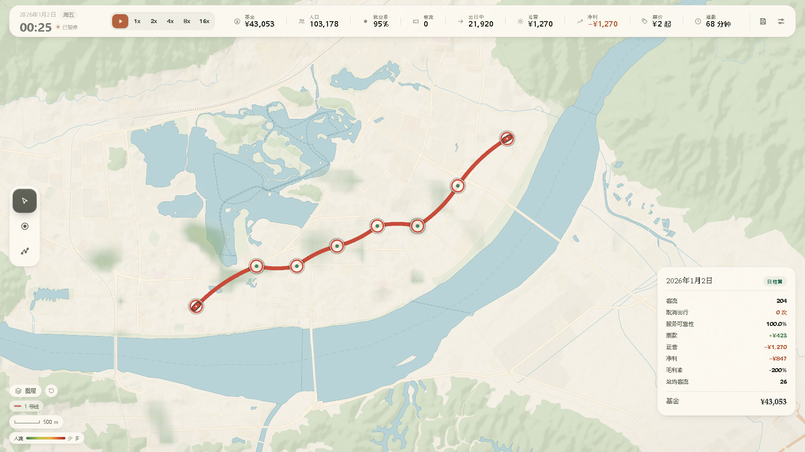
</p>
<p align="center">
  <sub>车站候车 / 容量 / 进出站 · 实时热力 / 功能区 / OD 流带 · 每日 00:00 经营结算</sub>
</p>

## 快速开始

环境要求：Node.js ≥ 20（本项目在 Node 24 上开发）、支持 WebGL 的现代浏览器。

```bash
npm install
npm run dev          # http://127.0.0.1:5173
npm run build        # 类型检查 + 生产构建到 dist/
npm run preview      # 预览构建产物
npm run test         # 104 项模拟 / 地图数据单元测试
```

## 玩法

1. 选择「新游戏」→「标准局」或「新手局」，或进入 **创作模式** 制作一张自己的地图。
2. 用 **放站** 在地图上点击位置：单击后预览固定，移动鼠标不会带走面板；**放站面板顶部可以选站型**（小型站 60 人 / ¥600、标准站 100 人 / ¥1,000、大型换乘站 250 人 / ¥3,000），标题栏可拖动、右上角可收起，方便继续观察地图。**确认后不可撤销**（新手局附一次例外）。
3. 用 **画线** 依次点击车站，按回车或「完成」建成线路；**点回起点会闭合成环线**（至少 3 个站）。每段 ¥500，新线自带 1 列车（¥2,000）。建成后在线路面板点 **「延长线路」**：点击线路外侧新站可接到两端，点击**中间站**可从此处分出一条共用颜色的支线；只按新增区段收费。
4. 画线面板里可以为这条线路 **选颜色**（6 个预设 + 自定义取色器）和 **运营时段**（默认 06:00–23:30）。建成后随时在线路面板修改。
5. 按空格开始。有人 5 点多就出门赶早班，早高峰从 6:30 起逐步爬升；07:00–09:00 与 17:00–19:00 自动切 1x：早高峰热力沿“住宅 → 站点”亮起，晚高峰切到“就业 → 站点”，平峰客流少、热力自然变淡（不做额外压暗）。早/晚高峰提示只提示，不暂停。
6. 点击车站查看候车/容量与进站人数；点击线路加车、减车、延长或拆线；点击空白组团查看 OD 摘要。
7. 左下角线路图例：点击某条线，地图上只高亮该线，其余线路变淡；再次点击取消。旁边「图层」按钮打开底图 / 实时热力 / 功能区气泡 / OD 流带 / 线路 / 站点与列车 / POI 开关。左下角刻度尺随 Ctrl + 滚轮缩放更新；查看模式可直接左键拖动地图，右键/中键也可平移。
8. 每天 00:00 结算：票款按**分段票价**计（起步 ¥2 含 6 km，之后每 6 km +¥1；点 HUD 的「票价」可调）；运营 = 列车 × ¥100 + 车站日运营（小型 ¥20 / 标准 ¥30 / 大型 ¥80，含闲置站）。

### 默认客流：混合 + 活动链

- **活动链模型默认开启**：每个 agent 不再只有“去程 → 返程”，而是按群体生成 1–6 段活动链；包含午间办事 / 购物 / 就医、下班购物 / 休闲 / 办事、少部分家长接孩子。旧的单次 `out/back` 只用于旧存档兼容。
- **混合客流**：约 10.2 万个 agent，包括通勤、反向通勤、灵活出行，以及就医 / 休闲 / 接驳 / 学生四类 POI 专项出行；7 个行为群体下再分 **18 类人群画像**（办公室 / 服务业 / 产业工人、老人就医 / 陪护、本地休闲 / 游客、铁路 / 渡口接驳、小学 / 中学 / 高校走读住宿等）。任务结构按人稳定：约 **80% 的人连续几天走同一条回家路线**，约 **20% 的不规律者**（弹性 / 休闲 / 学生等）每天换任务；所有人的出发时刻有 ±3–4 分钟抖动。
- **POI 正常产生客流**：医院 17:00 截止、学校工作日双峰、商场软截止、渡口脉冲班次都会进入 OD 流带和热力。
- **没有地铁时城市仍然在动**：agent 按步行 / 电动车 / 公交 / 汽车完成出行，热力图统计这些背景出行；建站后，有可达方案的人坐地铁。
- **`?commuter=1` 纯通勤实验**：只保留 5,692 个通勤者（80% 正向 + 20% 反向），POI 只作地标，用于对比“纯通勤网”。
- **`?m1=1`**：启用 M1 合成人口（家庭 / 学生 / 退休者），适合进一步调试混合客流。
- **M3/M4 默认开启**：背景步行/电动车走路网，公交/汽车走机动车图；路由按 OD 缓存、分帧生成，找不到主路网时回退直线。`?m3=0&m4=0` 可关闭。

### 操作

| 操作 | 按键 / 方式 |
| --- | --- |
| 暂停 / 继续 | `空格` |
| 放站 / 画线 / 查看 | `B` / `L` / `V`，或左侧工具栏 |
| 确认放站 / 完成画线 | `Enter` |
| 取消预览 / 取消画线 / 关闭面板 | `Esc` |
| 缩放地图 | `Ctrl` + 鼠标滚轮（1x–5x，最小为全图） |
| 平移地图 | 查看模式下按住左键拖动，或按住右键/中键拖动 |

| 图层显示 | 左下角「图层」按钮：底图 / 实时热力 / 功能区气泡 / OD 流带 / 线路 / 站点与列车 / POI，可一键全部显示或只看底图 |
| 保存 | 顶部保存按钮或 `Ctrl/Cmd + S` |
| 退出当前选择 | 点击空白地图 |

### 实时热力（REQ-HEAT-001 / 002 / 003）

热力显示的是**正在外出的人**，不是静态人口：

```text
当前热力 = 步行途中的人 + 站内候车的人 + 列车上的乘客 + 站点排队溢出
```

- **数据来源**：只统计**正在路上**的人——步行按“家/公司 → 站”与“站 → 目的地”的进度插值并拖出尾迹，候车落在站上，乘车跟着列车走；在家、在岗的人不计入。顶栏「出行中」显示的就是这个人数。
- **刷新频率**：每 **10 游戏分钟** 重算一次（建站 / 拆线等线网变化会立即重算）；两帧之间再做 Lerp，热力像在流动。
- **不做按时间压暗**：平峰热力变淡只是因为路上的人真的少了（08:30 约 340 人、13:00 约 90 人），同一时刻的明暗完全由实际客流决定。
- **潮汐**：早高峰沿“家 → 站”亮，晚高峰沿“站 → 家”亮；13:00 客流少，热力自然变淡。**不做任何按时间压暗**，亮度只由实际流量决定。
- **渲染**：256×144 网格上传为纹理，自定义 WebGL shader 做双线性采样 + 调色板（暗绿 → 黄 → 橙 → 红 → 闪烁深红）+ 呼吸 / 流动动画；地形图用陆地掩膜裁掉水面，不会糊到西江上。
- **站点**：图标按 `候车 / 承载力` 从绿渐变到红；**站型越大图标越大**（小型站小圆点、标准站单圈、大型换乘站双圈 + 外环），超过 90% 后出现外扩红色波纹、轻微震动；悬停弹出气泡：「当前站口承载力已达 158%，超过 23 人正在站外排队等待，满意度暴跌。」
- **图层**：默认开启「实时热力」；功能区气泡与 OD 流带默认关闭，需要时可在图层面板打开。

### 列车运行区间与收车

- 线路面板里每列车都有 **始发站 / 终点站** 两个下拉框：可以只跑一小段（短交路），到终点自动折返，不会再跑到区间外。
- 收车时间只限制“发车”：**末班车会把当前一程跑完**，实际到达自己的终点站后才停下，收车时间 09:00 的车 09:05 到站是正常的。
- **夜间跳过会等末班车**：00:00 只结算账目，不会立刻跳时间；等最后一列车回到自己的终点站、车上没人之后，才跳到当天第一班出发前（约 04:43）。
- **首班错开**：夜里停在同一个终点站的多列同类型车，第二天会按当前班距依次发车（06:00、06:00+班距、…），不会同时涌出。
- **慢车 / 快车**：线路面板「加车」可选慢车（各站停，¥2,000 / ¥100 日运营）或快车（大站停，¥2,600 / ¥130 日运营）。第一次加快车会弹出停靠站勾选，默认勾上大型换乘站、5/6 级 POI 附近站与线路两端；之后可在线路面板「快车停靠 · 编辑」随时改。慢车仍然每站都停。
- **环线**：画线时点回起点即闭合；已有线路点「延长 / 分支」后**直接点回自己的端点就能闭合**（A·B·C 点 A 补出 C→A，只收 1 段 ¥500），也可以先接出新站再点回端点。线路面板显示「环线一圈」；列车单向循环、到终点不折返，闭合后的环线不再支持分段运行或继续延长。
- **快慢车自动分流**：A* 给同一条线建两种边——慢车边班次密、逐站停，快车边班次稀、只停大站。短途乘客自然坐慢车，长途乘客等快车；快车满载时部分长途乘客会退回慢车，不需要手动分配。
- 线路面板同时记录本线的 **实时 / 峰值客流** 与 **昨日 / 最高日客流**：实时是当前车上人数，峰值是历史最高在车人数，昨日是上一个结算日总上车人次，最高是历史单日最大。
- 折返、区间、运营时段都会写进存档；旧存档没有区间字段时自动补成整条线。

## 0.9.2 新增

- **实时热力**：热力改为“步行 / 候车 / 乘车中的外出人口 + 站点排队溢出”，每 10 游戏分钟刷新；用 WebGL shader 渲染平滑热力层，站点图标按承载力绿→黄→红渐变，超载时出现波纹、震动和悬停气泡。
- **列车运行区间**：每列车可单独设置始发站 / 终点站，到终点自动折返；运营结束时间只限制发车，末班车会跑完当前一程再收车。
- **继续填满地图**：新增端州东（东岗、岩前、厚岗、端州东城）、高要（高要城区、白土、回龙、高要产业园、金渡工业）、鼎湖南（永安、沙浦、莲花、鼎湖工业、永安物流）、四会（四会城区、大旺、贞山、龙甫、四会高新区、大旺工业）共 13 个住宅组团 + 7 个就业组团，组团总数达到 **55**。
- **更多 POI**：端州图书馆、岩前村、北岭山、将军山、东门广场、高要区中医院、高要区第一中学、高要体育中心、鼎湖体育公园、沙浦渡口、四会站、四会市人民医院、四会中学、贞山风景区、大旺公园；内置 POI 达到 **47** 个，四会右上角与高要下部现在也有完整客流。
- **从中间站分支**：延长线路时，点击线路**中间站**即可从该站分出一条支线。支线共用干线的颜色与运营时段，有自己的列车，在分支站换乘；点击头 / 尾外侧的新站仍然按原来的方式延长。
- **延长预览不再有虚线**：进入延长 / 分支后，只预览玩家已经点选的**新区段**，不再画跟随鼠标的虚线；原有区段保持线路本色和原粗细，新段用该线颜色 + 白描边预览，点「完成」后才真正计费。
- **版本**：界面与包版本升到 **0.9.2**；存档格式仍为 0.9.0，旧存档可直接读取。

## 0.9.1 新增

- **图层面板搬到左下角**：从顶栏移到左下角「图层」按钮；改用带色点的开关列表，底部提供「全部显示 / 只看底图」，右上角有明确的关闭按钮，点击面板外也会收起。打开时不再盖住左侧工具栏。
- **延长既有线路**：线路面板新增「延长线路」。进入后点击新车站，会自动接到较近的一端（首端或尾端）；完成后只按新增区段收费，列车与运营时段保留。可在一次操作里同时向两端延长。预览只显示已经点选的新区段，不会用虚线跟着鼠标暗示一条还没选的路。
- **取消最小站间距**：相邻车站可以建得很近，不再提示“距离已有车站太近”；是否值得建由玩家自己判断。
- **车站方向命名**：同一组团内第二座及以后的车站，按相对于组团中心的位置使用 **东 / 南 / 西 / 北**；四个方向都用过之后再使用 **东北 / 东南 / 西南 / 西北**；超过 8 座才退回编号命名。
- **更多组团**：新增三村、棠下、康乐、宋城、河旁、石牌、沙湖、迪村、蕉园、水坑 10 个住宅组团，以及黄岗工业园、蓝塘物流园、城西商贸、桂城工业园、广利港 5 个就业组团。
- **更多 POI**：新增端州区妇幼保健院、市第二人民医院、端州体育馆、梅庵、包公祠、崇禧塔、肇庆粤运汽车总站、鼎湖区中医院、鼎湖实验中学、砚阳湖公园、九龙湖，内置 POI 增至 32 个。
- **版本**：界面与包版本升到 **0.9.1**；存档格式仍为 0.9.0，旧存档可直接读取。

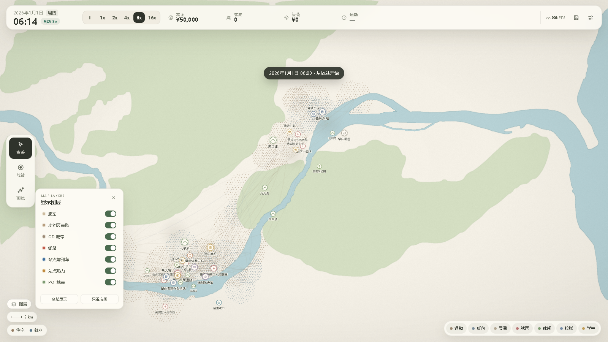

## 0.9.0 新增

- **POI 6 级分级**：每个 POI 有 1–6 级（1 邻里 → 6 国家级），等级决定图标大小、外环、名称标签字号、OD 流带粗细、覆盖权重和基准客流。内置地图最高 5 级、没有 6 级（按规则一张图 0–2 个）。
- **同级规模 `scale` 与日吸引量区间**：同级 POI 用 0.5–1.2 的 `scale` 拉开强度，`dailyRange = 基准 × scale × [0.85, 1.15]`；agent 按这个区间抽样分配。
- **到达时间画像**：硬截止（医院 17:00）、软截止（商场 22:00 前变细）、脉冲（渡口班次）、双峰（学校上下学）、持续（火车站/景区）。每个 POI 可设开放 / 截止时刻。
- **取消出行**：硬截止 POI 按当前线网估算，赶不上截止的 agent 当天取消，结算卡片显示“取消出行 X 次”和“服务可靠性”。
- **动态 OD 流带**：流带按当前时刻的画像强度绘制，硬截止后消失、软截止变细、脉冲变粗、周末切换；每 1–2 秒刷新，不逐帧动画。加车缩短候车时间后，部分截止前流带恢复。
- **POI 名称标签**：按等级字号绘制，等级高的优先摆放；挤在一起时低等级标签自动隐藏，避免端州老城糊成一片。
- **创作模式**：POI 面板改为 **等级 1–6 + 同级规模 + 时间画像 + 开放/截止时刻**，实时显示预计日吸引量区间；旧地图的 `weight` / `window` 会自动迁移。
- **存档升级**：`SAVE_VERSION` 升到 **0.9.0**；旧存档缺失的等级、画像、取消统计会自动补齐。

## 0.8.1 新增

- **按坑口调整鼎湖片区**：在初始 19 个 POI 基础上去掉鼎湖站（初始没有此点），新增 **鼎湖东站（1320,480）** 与 **砚洲岛（1400,560）**；鼎湖山从 1270,510 左移到 **1150,590**（坑口左侧）；肇庆新区调到 **1450,560**（坑口东侧）。端州 13 个及其余 POI 保持初始坐标；0.8.1 时总计 21 个。广利仍为 1490,420，缩放/线路/图层等其它系统不动。
- **地图比例尺与缩放**：地形底图 **1 km ≈ 50 px**，纯色图 **1 km ≈ 23.4 px**。Ctrl + 滚轮缩放，**最小缩到全图**（不再允许 0.6x，地图不会显示得过小）；查看模式左键拖动或右键/中键拖动平移，平移有边界。左下角刻度尺缩短，只保留刻度线 + 距离，不再显示 ×1 与「复位」。
- **图标尺寸**：站点、POI、线路与列车按屏幕像素固定，放大 / 缩小地图不会把它们一起放大；缩小时 POI 徽章重叠，按等级优先保留高等级，低等级暂时隐藏，放大后恢复。
- **放站预览固定**：点击地图后预览与信息面板固定，移动鼠标不再跟随，可以直接用鼠标点「确认放站」。
- **线路颜色与运营时段**：画线时选颜色（预设 / 取色器），设置开始与结束时间；建成后在线路面板随时修改。列车只在运营时段内运行，时段外停运。
- **线路图例高亮**：左下角列出全部线路，点击只高亮该线，其余线路透明度降到 16%；没有线路时图例整个隐藏，不显示占位文字。
- **图层开关**：底图、功能区点阵、OD 流带、线路、站点与列车、站点热力、POI 七层独立显示/隐藏。
- **FPS 指示**：顶栏显示实时帧率，低于 55 变琥珀色、低于 35 变红色。
- **移除目标与未覆盖显示**：HUD 不再显示「送达 / 计划行程」「未服务」，游戏没有完成条件。
- **高峰提示不暂停**：06:50 / 16:50 仍会提示早/晚高峰，但只弹提示，不打断操作。
- **线路编号与颜色解耦**：线路名按建成顺序（1 号线、2 号线…），颜色只决定外观，不会出现「第一条线叫 2 号线」。

## 创作模式

主菜单 →「创作模式」。底图、比例尺、区域、POI 都是独立数据层；底图只做参考，不参与模拟。

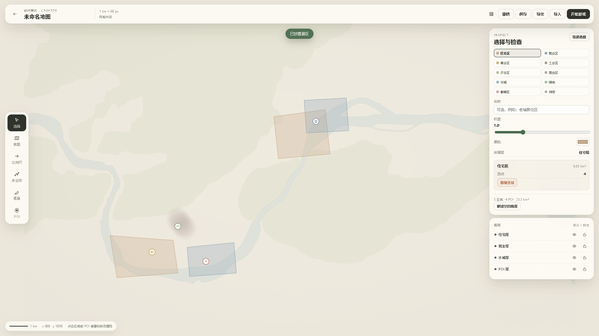

### 1. 导入并校准底图

- 支持 **PNG / JPG**（≤ 12MB）。导入后自动适应画布，可拖动平移、滚轮缩放、面板旋转。
- **透明度 10%–30%**，避免盖住绘制层；可一键隐藏。
- **比例尺校准**：在图上拉一条线，输入「这段代表多少公里」，得到 `px/km`。之后所有半径、步行距离、区域面积、网格尺寸都基于这个比例尺。
- **网格**：可开关，间距按比例尺换算（250 m / 500 m / 1 km / 2 km）。

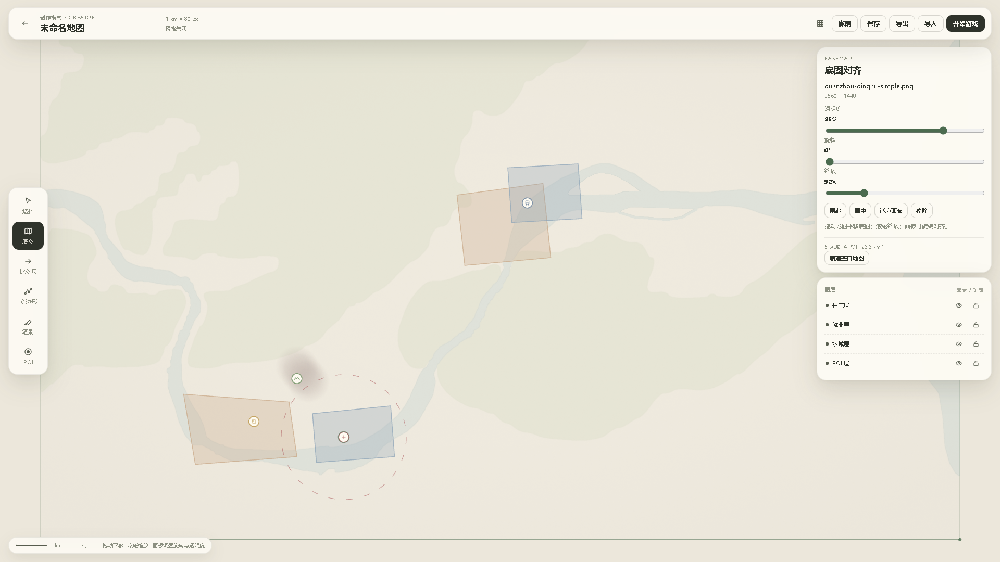

### 2. 绘制区域

- 10 种区域：住宅、就业、商业、工业、农业、混合、水域、绿地、敏感区、待定。
- **多边形**：逐点点击，点击起点或按 `Enter` 闭合；`Esc` 清空。
- **笔刷**：按住拖动涂抹，可调大小、硬度、擦除。重叠笔迹会形成密度梯度，边缘自动衰减——不需要精确到街道。
- 每个区域有类型、权重（0.2–3.0）、名称（可选）、低饱和颜色；面板实时显示面积（km²）与顶点/笔迹数。
- **图层**：住宅层、就业层、水域层、POI 层分别显示/隐藏/锁定；锁定图层不会被误选或误画。

### 3. 放置 POI

类型：医院、景区、火车站、渡口、学校、商场、公园、体育馆、机场、工业园门口。

- 每个 POI 有类型、位置、**1–6 级**、同级规模 `scale`、服务半径（km）、到达时间画像、开放/截止时刻、日吸引量区间。
- 面板实时显示“预计日吸引 8,400–11,400 人”；改等级会同步默认半径与区间。
- 点击地图放置；选中后显示影响半径，可调等级、规模、画像、时刻、半径。
- **等级决定图标、外环、名称标签、OD 流带与覆盖权重**；同级之间用 `scale` 拉开差异。
- **对玩法的回流**：

| POI | 产生群体 | 默认画像 | 备注 |
| --- | --- | --- | --- |
| 医院 | 就医出行 | 硬截止 08:00–17:00 | 17:00 后不再到达，赶不上则取消 |
| 景区 | 休闲出行 | 软截止 08:00–18:00 | 闭园前流带变细；45% 仅周末 |
| 商场 | 休闲出行 | 软截止 10:00–22:00 | 22:00 前逐渐变细 |
| 学校 | 学生出行 | 双峰 07:00–17:00 | 仅工作日 |
| 火车站 / 机场 | 接驳 / 休闲出行 | 持续 05:30–23:00 | 全天缓慢升降 |
| 渡口 | 接驳出行 | 脉冲 06:00–22:00 | 每 30 分钟一班 |
| 体育馆 | 休闲出行 | 脉冲 18:00–22:00 | 傍晚 |
| 公园 | 休闲出行 | 持续 06:00–22:00 | 周末 ×1.3 |
| 工业园门口 | 不额外产生 | 硬截止 07:00–19:00 | 作为地标与就业参考 |

POI 会创建新的出行组团，OD 流带用对应群体的颜色绘制；筛选栏会出现「就医 / 休闲 / 接驳 / 学生」按钮（没有该群体的地图不显示）。

### 4. 导出、导入与开始游戏

- **导出** `.json`：可选「打包底图」（JSON 变大）或「仅保留文件名引用」。
- **导入** `.json`：恢复区域、POI、图层、比例尺与底图（若打包）。
- 编辑内容会自动保存到浏览器草稿；「保存」会额外写入地图库。
- 点「开始游戏」：按比例尺换算步行半径（最大 2 km，核心 500 m）与步行速度（4.5 km/h），把区域与 POI 变成真正可玩的地图。车站间距不受限制。游戏存档通过 `mapId` 引用底图，因此同一浏览器读档可恢复参考底图。

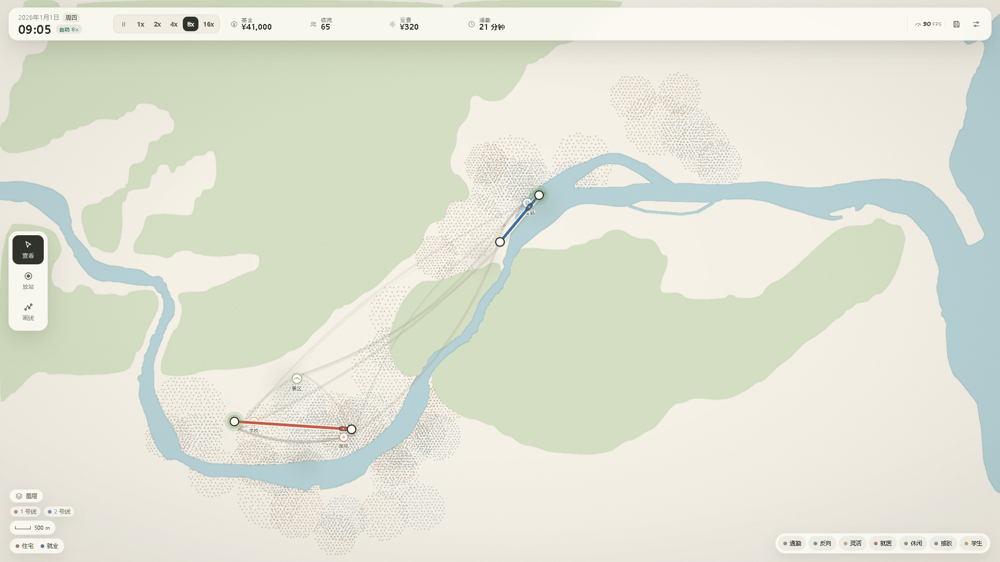

### 创作模式快捷键

| 操作 | 按键 |
| --- | --- |
| 选择 / 底图 / 比例尺 / 多边形 / 笔刷 / POI | `V` / `G` / `M` / `P` / `B` / `O` |
| 闭合多边形 | `Enter` 或点击起点 |
| 取消当前绘制 / 返回选择 | `Esc` |
| 删除选中区域或 POI | `Delete` / `Backspace` |
| 撤销 | `Ctrl/Cmd + Z` |

## 已实现的核心规则

### 时间与日历
- 真实公历（闰年、月长、星期），从 **2026-01-01 06:00** 起步，一天约 6 分钟现实时间。
- 动态压缩：夜间 16x、早高峰前 8x、早高峰 1x、平峰 8x、晚高峰 1x、夜间前 8x；跨时段自动恢复自动速度，可锁定手动速度。
- 暂停时时间、列车、agent 全部静止，但可以放站、画线、加车、拆线、切视图。
- 每天 06:50 / 16:50 只提示早/晚高峰，**不自动暂停**（可在设置关闭提示）；夜间跳过开关默认开启，会直接推进到当天第一班出发前（约 04:45–05:30），不会把 5 点多的早班一起跳过。
- 每天 00:00 结算并弹出 2 秒结算卡片，同时写入自动存档；日期按公历滚动。

### 群体与客流
- **默认混合客流**：内置地形图约 **10.2 万个 agent**，纯色图按同一比例放大。基础成年样本约 **3.7 万人**（70% 正向 + 10% 反向 + 20% 灵活），另有就医、休闲、接驳、学生四类 POI 专项出行。
- **学生不是“全校每天通勤”**：学校 POI 只按走读比例生成日客流；约 **40% 的学生是住宿生**，工作日住校、`dayRule=2` 只在周末 / 假期激活，从学校回所在区的家再返校。鼎湖 / 高要 / 四会等外围学校住宿比例更高（约 58–68%），端州城区走读约 78%。当前学生 agent 约 **1.5 万（14.6%）**，其中约 **40%** 是住宿生；不再是 30%。
- **每个 agent 有车辆与个人速度**：约 **58% 步行、32% 电动车、10% 汽车**；步行 4.0–5.4 km/h、电动车 13–21 km/h、汽车 24–44 km/h。没有车就只能步行，有车 / 电动车后对应方式会直接决定任务链和背景行程的耗时。
- **约 4,700 名通勤者的工作地直接是 POI**：商场店员、医院职工、学校教师、景区 / 车站工作人员等，不是“去 POI 办事”，而是把 POI 当单位；他们的硬截止、工作地重选等逻辑会和访客区分开。
- **住宅起点按单元人口加权**：端州有 4,819 个住宅 cell（占 cell 数 85%）但只占 54% 人口；高要 / 鼎湖 cell 少、单格人口大。按 cell 个数平均抽会让端州独占八成 agent，热力图上其他区几乎空白；现在按 `cell.population` 抽样，agent 与热力分布回到人口比例。
- **禄村数据已修正**：旧数据把 1.34 km² 工业厂房足迹误当成住宅面积，再被区县控制总量放大到 **6.8 万人**；现在无住宅足迹的单元只按 place 点给小村范围，禄村约 **1,588 人 / 0.06 km²**，不再出现金利孤立红点。运行时仍保留 cell 半径散布作为兜底（最大 120 px）。
- **POI 专项出行**：总量按日吸引量生成，**目的地由 agent 自己选**（吸引力 / 距离^α）；`?commuter=1` 可切成 5,692 个纯通勤者（80% 正向 + 20% 反向），不生成 POI 专项。
- 出发时刻按“上班 / 下班时间分布 − 估算通勤时间”抽样，带早晚尾巴；周末约 90% 通勤族不出行。学生仅工作日，部分休闲族仅周末。
- 站点步行辐射：核心 500 m、最大 2 km；按距离概率选择地铁（0–300 m 85%，500 m 70%，1.2 km 45%，2 km 5%，2 km 外为 0）。起终点概率相乘；未通过概率计未服务。
- A* 在 2 km 内选择起终点车站，按「步行 + 候车 + 乘车 + 换乘 1 分钟」寻路；无站/不可达计入内部未服务统计（不再显示在 HUD）。
- 硬截止 POI 赶不上截止则取消当天出行，结算显示取消次数与服务可靠性；软截止 / 脉冲 / 双峰不会硬取消。
- 列车沿线路往返，区段运行 = 站距 ÷ 100 km/h，停站 1.4 分钟、容量 120；满员候车会继续累积并变红。
- 站点热力 = 候车 / 200，绿→黄→红；闲置站显示为空心灰圆。
- **实时热力只画“正在路上”的人**（步行 / 候车 / 乘车 / 背景方式），不是常住人口。08:00 约 1,300 / 22,000 人在外，其余在家或在岗；因此热力天然是走廊状，不等于人口分布。稀疏村落的单个行人不再被 0.18 阈值抹掉，阈值已降到 0.10。
- POI 专项出行不再由 POI “指定人数”：各组只拿总预算，每个 agent 在自己这一组里按 `日吸引量 / 时间^α` 抽样选目的地；α 随等级从 1 级 2.2 降到 6 级 1.1，等级越高越可能跨城。等级高、`scale` 大、离家近的 POI 自然更强，边远小 POI 可能一个客人都没有。
- **目的地随线网重选**：时间取「地面 18 km/h + 6 分钟候车」与「地铁门到门」的较小值；修了新站 / 新线后，原本超过步行辐射的 POI 进入选择集，远端目的地的份额上升。线网变化时全量重算，平时每天只让约 15% 的 POI 出行换目的地，制造逐日波动。
- **返程按实际到达排**：不是固定 `backMin`，而是「实际到岗时刻 + 停留时长」。早高峰被挤慢的人，晚高峰自然跟着后移，形成真实的晚归尾部；顺路多站也从这里接出去。
- **通勤族会换工作地，但很慢**：线网修好后，原本太远的就业组团进入可选范围。修线后先过 **3 天适应期**（期间没人换），之后每天约 **0.6%**（约每周 4%）的通勤族改去别的就业组团；选择按 `岗位数 / 时间^2` 抽样，和 POI 出行用的是同一套时间口径。不会出现“今天修完线、明天全城换工作”。
- **午间 / 下班任务**：约 **33% 的 agent 有 3 段以上行程**，平均 **2.4 段/人**（旧 M2 只有 2.06 段）。约 12–26% 的通勤 / 灵活族会在午间去附近购物、办事或医院再回单位；下班后有 12–58%（按群体）的人去 1 个购物 / 休闲 / 办事 POI，约 6–20% 的人会再去第 2 个；少数有孩子的家长 16:00 左右提前离开去学校接人。停留点按「吸引量 / 距离^α」在单位周边 3.5–8 km 内挑，停留 20–75 分钟，走不到的顺路点按未服务处理。
- **城市会长**：站点 800 m 内的住宅组团每天新增约 3% 的居民（新 agent，最多长到开局点阵的 1.5 倍）。新居民按「岗位多、离家近」挑工作地，第二天就通勤——车站周边越久，客流和票款越高，形成「修路 → 开发 → 更多客流」的循环。

### POI 分级与时间画像
- 默认混合客流下这些规则直接作用于 OD 流带、热力和建站覆盖；只有 `?commuter=1` 纯通勤局会把 POI 降级为地标，不生成专项出行。
- 1 级邻里（600 人/日）→ 6 级国家级（80,000 人/日）；内置地图最高 5 级，不设 6 级。
- `dailyRange = 等级基准 × scale × [0.85, 1.15]`；同级 `scale` 允许 0.5–1.2。
- 画像：硬截止、软截止、脉冲、双峰、持续；每个 POI 有开放 / 截止时刻，周末按类型切换（学校周末 0，景区/公园/商场/体育馆 ×1.3）。
- OD 流带按 1–2 秒刷新画像强度，硬截止后归零；加车缩短候车时间后，部分截止前流带恢复。
- 默认建站预览显示“覆盖 POI 吸引”，按等级权重 × scale 累加；`?commuter=1` 纯通勤局隐藏这一项。

### 线路与运营
- 每条线路有编号、颜色（预设或自定义 hex）、运营时段、站序与列车。
- 列车只在 `startMin–endMin` 内发车；在途的末班车会跑完当前一程到自己的终点站再停。默认 06:00–23:30。
- 线路图例点击高亮；其余线路不隐藏，只把线路本身降到 16% 透明度。
- 线路面板可改颜色、开始/结束时间、加车/减车/拆线；显示总里程、设计时速、单程和班距。
- 区段运行时间按 `站距(km) ÷ 100 km/h` 计算，站距越长耗时越长；单程另加每站 1.4 分钟停站。

### 经济与永久性
- 初始基金 ¥50,000；放站按站型 ¥600 / ¥1,000 / ¥3,000、每段 ¥500、慢车 ¥2,000、快车 ¥2,600；拆线返还 50% 建设费；减车不返还购买费但停止其日运营成本。
- 车站没有删除接口，站点卡片只有候车、进站、是否接入线路与线路列表。
- 基金为负不能新建、不能拆线；闲置站每天照扣 ¥30。
- **分段票价**：起步价 + 含公里 + 每段公里/加价四项，点 HUD 上的「票价」打开面板用步进器调整；票款按每次上车的实际线网里程算，换乘不重复收。面板里有一行「3/8/14/20/30 km 各收多少」的即时预览。
- 新手局提供一次「撤回最近车站」（返还 ¥1,000），正式局没有。

### 存档
- IndexedDB：3 个手动槽位 + 1 个自动槽位；每日结算后自动保存；手动保存不暂停。
- 导出 / 导入 `.json`，校验 `saveVersion`，版本不匹配给出提示；存档格式为 **0.9.0**。
- 主菜单：继续（最近存档）/ 新游戏 / 载入存档 / 创作模式 / 导入存档；加载后保留存档时的暂停状态。
- 自定义地图存档只保存区域/POI/比例尺，底图通过 `mapId` 引用地图库；换设备导入游戏存档时底图可能缺失，但不影响模拟。

## 界面

| | |
| --- | --- |
| 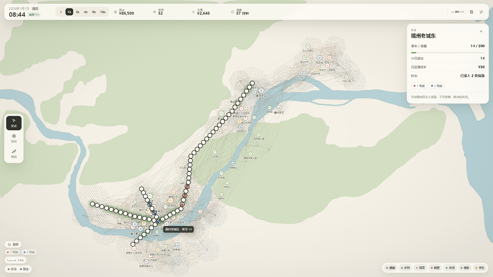 | 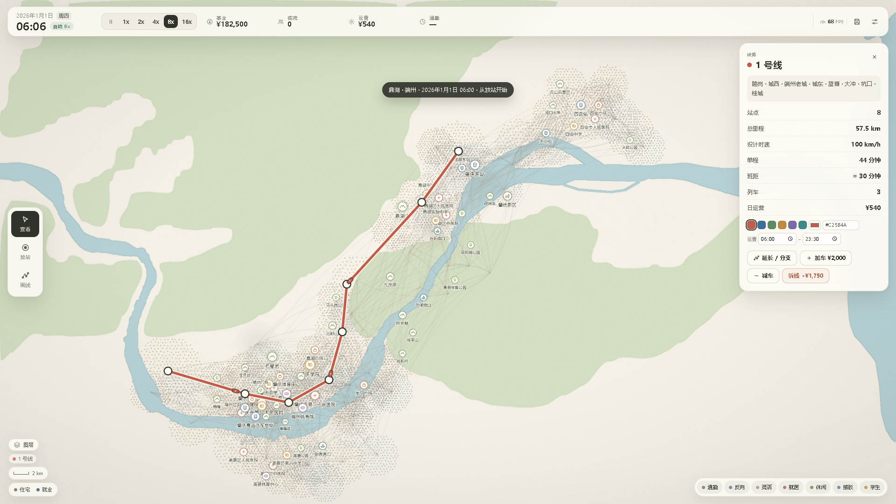 |
| 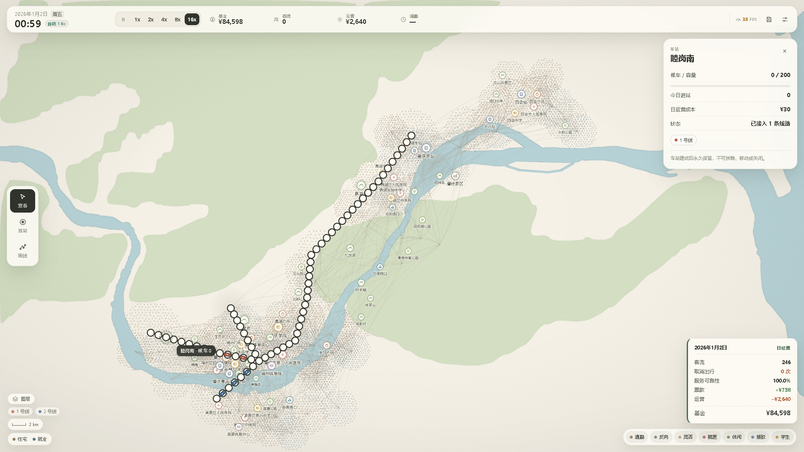 | 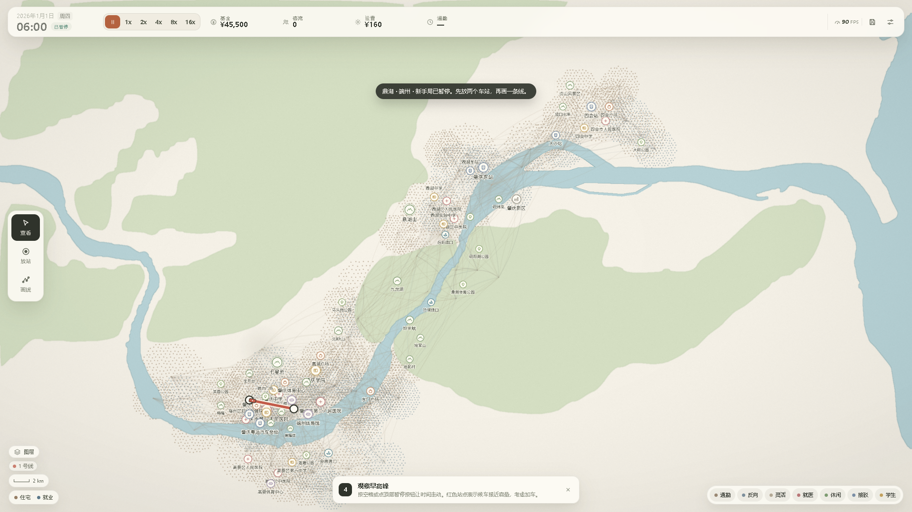 |

## 技术架构

```
src/
  sim/          纯 TypeScript 模拟核心（不引用 PixiJS / DOM）
    calendar.ts     公历、时段、速度边界
    constants.ts    全部数值标定、7 类群体、线路颜色
    builtinPois.ts  旧地形图 POI 数据（已由 map/game-data 替换）
    zones.ts        旧地形图组团与点阵（纯色图/回退仍用）
    mapData.ts      创作模式地图数据：区域/POI/比例尺/点阵采样/六级分级/时间画像
    population.ts   基础群体 + POI 群体生成（住宅/就业引力模型）
    network.ts      车站/线路/列车数据结构（无 removeStation）
    pathfinding.ts  按时间 A*（换乘 1 分钟 + 候车估计，支持自定义步行半径）
    simulation.ts   时间推进、事件、客流、经济、结算、线路运营时段
    save.ts         序列化 / 反序列化（含自定义地图、线路颜色/时段）
    storage.ts      游戏存档 IndexedDB
    db.ts           存档与地图共用数据库
  editor/       创作模式
    editor.ts       底图变换、比例尺、区域绘制、POI、图层、导入导出
    mapStore.ts     地图库与草稿
  render/       PixiJS v8 渲染层
    mapAssets.ts    底图、点阵贴图、水面/山体掩膜
    scene.ts        线路、热力、站点、列车、OD 流带、POI 分级图标与标签、镜头缩放
    poiGlyph.ts     极简 POI 图标
    softCircle.ts   笔刷柔边贴图
  ui/           DOM 覆盖层（HUD、面板、菜单、图例、图层、FPS、比例尺）
  game/         Game：输入、工具、存档流程、创作模式与主循环
```

- **架构铁律**：`src/sim` 不 import 任何渲染或 DOM 模块，只暴露状态与操作；渲染层每帧只读快照。
- 逻辑 tick 以 `requestAnimationFrame` 驱动，单帧 `dt` 上限 0.25s；按 `deltaRealSeconds × 速度` 推进游戏分钟，并在 00:00 / 06:00 / 06:50 / 07:00 / 09:00 / 16:50 / 17:00 / 19:00 边界精确切分。
- 镜头：`fitScale × zoom + pan`，Ctrl+滚轮以鼠标位置为锚点缩放（1x–5x），查看模式左键/右键/中键平移；平移被夹取在地图边界内，地图始终覆盖视口。
- OD 流带按组团对聚合绘制，渲染量与原 agent 数无关。
- 地图使用 `assets/maps/duanzhou-dinghu-simple.png`（2560×1440），水面与山体通过像素采样生成掩膜，点阵自动避让水面/山体。
- 自定义地图的步行半径 = 2 km × px/km，步行速度 = 4.5 km/h，站距 = 0.25 km；POI 半径与区域面积同样按 px/km 换算。

## 验证

```bash
npm run test                        # 104 项核心测试
node tools/smoke.mjs                # 需要先 npm run dev；建设/结算/存档流程
node tools/smoke2.mjs               # 新手局、筛选、设置、菜单、导出导入
node tools/editor-smoke.mjs         # 创作模式：底图/比例尺/多边形/笔刷/POI/开始游戏
node tools/newfeatures-smoke.mjs    # 缩放/比例尺/放站固定/线路颜色与时段/高亮/图层/FPS
node tools/editor-demo.mjs          # 生成创作模式演示截图
node tools/perf.mjs gpu              # 帧率采样（Chrome 路径可用 CHROME_PATH 覆盖）
node tools/shots.mjs                 # 生成 docs/screenshots
npm run check:build                  # 需要先 npm run preview；验证生产构建
```

实测：默认约 **10 万 agent** 时，主要成本在热力重算、背景方式路由与活动链重建；SwiftShader 软件渲染的 e2e 约 **15–30 FPS**（仅 CI 环境，非目标硬件），真实 GPU 需按机器实测。

## 数值与地图

- 地图：`assets/maps/duanzhou-dinghu-simple.png`，端州·鼎湖，16:9。
- 组团坐标取自 OSM 街道/社区/镇街中心，住宅与就业权重为手工标定；**所有经纬度统一写成 5 位小数（WGS84）**，并由 `tests/sim.test.ts` 校验。
- 内置 POI 的经纬度来自公开地点信息（OSM / 百度 POI 换算到 WGS84），投影到地图像素；部分位于河岸/山体的点做了少量陆地微调。
- 地图数据 © OpenStreetMap contributors（ODbL）；高程 AWS Terrain Tiles。详见 `assets/maps/README.md`。

## 已知简化（0.9.2 范围）

- POI 时间画像只作用于 agent 出发抽样与 OD 流带；不做逐人“到达前再次检查”，也不做“到了发现关门改去别处”。
- POI 目的地由可达时间决定：线网变化时全量重选，平时每天约 15% 的人换一处；当天正在进行的行程不改道，也不会因为修了站就中途换目的地。
- 取消出行只取消当天这一趟，不做改道、改目的地或跨日补行。
- **任务链不是完整家庭模型**：没有“先送孩子再上班”的前置链，接孩子是少数家长的单独一条提前下班支线；也没有把家庭成员之间的接送合并成一辆车。
- **任务选择是概率性的，但默认有“习惯”**：约 80% 的人连续几天保持同一条下班路线，只有约 20% 的不规律者每天重排；所有人出发时刻有小幅抖动。不会出现“全城每天重新抽签”，也不会一天之内因临时天气 / 心情改目的地。
- 午间 / 下班任务的范围受 POI 开放时间限制：医院 17:00 后、学校 17:00 后基本不再接新任务，找不到开放 POI 时任务会被删掉，而不是硬塞一个关门的点。
- **城市增长只长住宅**：就业岗位不跟着涨，所以开发会把片区变成“睡城”，通勤方向会更明显。
- **增长不进存档**：新增的居民（agent）会存，但点阵和“开局基数”不存；读档后地图点阵回到开局值，已长出的居民仍在，因此多次读档可能让点阵与 agent 数对不上。
- 硬截止的“加车恢复”通过候车时间影响可达性估算，不是逐人重排；恢复幅度取决于具体 OD 与截止余量。
- **支线**是共用干线颜色与运营时段的独立线路，在分支站换乘（1 分钟）；不是同一列车分叉跑的 Y 形轨道。
- 跨 00:00 时只结算当天账目：正在步行 / 候车 / 乘车的人**不会消失**，会继续走完；只有在家 / 在岗的人归位。
- 线路运营时段只约束列车运行；A* 的候车估计没有按时段过滤，末班后到站的乘客会在站里一直等到第二天首班车。
- 车站容量只参与热力显示，不是硬性候车上限。
- 列车区段耗时按内置地图比例尺换算（100 km/h），自定义地图按自身 `px/km` 换算。
- 笔刷区域面积用图章圆面积估算（扣除重叠），与精确栅格面积有少量差异。
- 「周末权重上升」通过 45% 休闲 agent 仅周末出行 + POI 周末系数共同实现。
- 不做到月度/年度报告、补贴、破产软失败；票价已支持分段调节，但客流不随票价变化（没有弹性）。
- POI 位置为近似投影，个别真实地点与简化地图的水系/山体不完全对齐。


